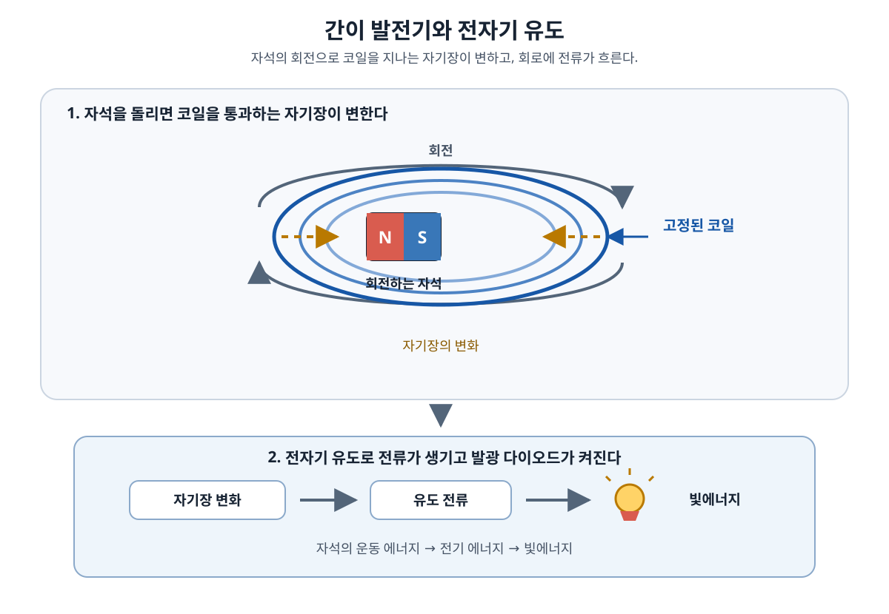

# 발전기와 전자기 유도

## 1. 간이 발전기의 작동 원리

간이 발전기에서 자석을 회전시키면 코일을 통과하는 자기장이 변한다. 이때 **전자기 유도**에 의해 코일에 유도 전류가 흐른다.



[그림 파일 보기](../../images/generator-electromagnetic-induction.svg)

```text
자석의 운동 에너지 → 전기 에너지 → 발광 다이오드의 빛에너지
```

발전기는 자석과 코일로 이루어져 있다. 발전소에서는 터빈이 발전기의 자석이나 코일을 움직여 전자기 유도를 일으키고 전기 에너지를 생산한다.

## 2. 발전 방식의 공통점과 차이점

- **공통점:** 터빈을 돌려 발전기에서 전자기 유도를 일으켜 전기를 생산한다.
- **차이점:** 터빈을 움직이는 에너지원이 다르다. 화력·원자력 발전은 증기로, 수력 발전은 물의 운동으로 터빈을 돌린다.

> **핵심:** 발전기에서는 운동 에너지가 전기 에너지로 전환된다.

---

[← 발전과 발전소](./발전.md) | [과학 목차](../../README.md) | [생물다양성 →](../생물/생물다양성.md)
