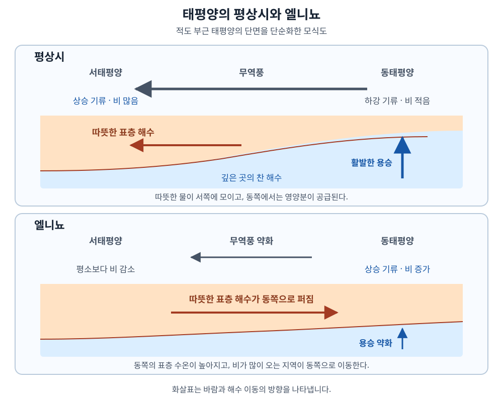

# 엘니뇨

## 1. 대기와 해수의 순환

대기와 해수는 순환하면서 지구 곳곳에 에너지를 전달한다. 이 순환이 평소와 달라지면 기온과 강수량이 변하고, 생태계와 사람들의 생활에도 영향을 줄 수 있다.

## 2. 평상시와 엘니뇨

**엘니뇨**는 적도 부근 태평양에서 무역풍이 평소보다 약해지면서 동태평양의 표층 수온이 평년보다 높은 상태가 한동안 지속되는 현상이다.

[이미지 파일 보기](../../images/엘니뇨%20비교.svg)

### 평상시

1. **무역풍**이 동쪽에서 서쪽으로 불어 따뜻한 표층 해수를 서태평양 쪽으로 밀어 보낸다.
2. 동태평양에서는 영양분이 풍부한 깊은 곳의 찬 해수가 표층으로 올라오는 **용승**이 활발하여 좋은 어장이 형성된다.
3. 따뜻한 서태평양에서는 상승 기류가 발달해 비가 많이 오고, 상대적으로 차가운 동태평양에서는 하강 기류가 발달해 비가 적게 온다.

### 엘니뇨 발생 시

1. 무역풍이 평소보다 약해져 서태평양에 모여 있던 따뜻한 표층 해수가 동쪽으로 퍼진다.
2. 동태평양의 표층 수온이 평년보다 높아지고, 찬 해수의 용승이 약해진다.
3. 상승 기류와 비가 많이 오는 지역이 동쪽으로 이동하여 동태평양의 강수량이 증가하고, 서태평양의 강수량은 감소하는 경향이 있다.

> **주의:** 엘니뇨 때 서태평양의 수온과 강수량은 평상시와 비교해 감소하는 경향이 있다는 뜻이다. 지역마다 실제 변화는 다를 수 있다.

## 3. 엘니뇨의 영향

| 구분 | 동태평양 | 서태평양 |
|---|---|---|
| 해양 생태계와 어업 | 용승이 약해져 영양분 공급이 줄고 해양 생태계가 교란되며 어획량이 감소할 수 있다. | 따뜻한 표층 해수가 동쪽으로 퍼지며 해양 환경이 변한다. |
| 날씨와 생활 | 강수량이 늘어 폭우와 홍수가 발생할 수 있다. | 강수량이 줄어 가뭄이 발생하고 농작물 수확량이 감소할 수 있다. |

## 4. 한눈에 비교

| 구분 | 평상시 | 엘니뇨 |
|---|---|---|
| 무역풍 | 동쪽 → 서쪽으로 분다. | 평소보다 약해진다. |
| 따뜻한 표층 해수 | 서태평양에 모인다. | 동쪽으로 퍼진다. |
| 동태평양 | 용승이 활발하고 강수량이 적다. | 표층 수온이 높아지고 용승이 약해지며 강수량이 증가한다. |
| 서태평양 | 표층 수온이 높고 강수량이 많다. | 평소보다 강수량이 감소하는 경향이 있다. |

> **핵심:** 무역풍 약화 → 따뜻한 표층 해수의 동쪽 확산 → 동태평양 수온 상승과 용승 약화 → 강수 지역 및 해양 생태계 변화

---

[← 지구 열수지 변동](./열수지변동.md) | [과학 목차](../../README.md) | [생물다양성 →](../생물/생물다양성.md)
