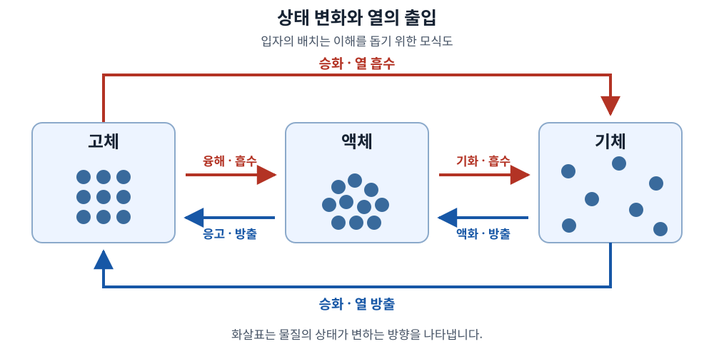

# 물질 변화에서 에너지의 출입

## 1. 물질 변화와 에너지

물질이 변할 때 에너지를 흡수하거나 방출할 수 있다. 에너지가 **열의 형태**로 출입할 때 주변의 온도 변화는 다음과 같다.

```text
열 흡수: 주변 ──열──> 물질    → 주변의 온도 감소
열 방출: 물질 ──열──> 주변    → 주변의 온도 상승
```

> **주의:** 전기 에너지처럼 열이 아닌 형태의 에너지가 출입하는 경우에는 주변 온도만으로 에너지 출입을 판단할 수 없다.

> **코딩으로 연결하기:** 데이터를 주고받을 때 송신자와 수신자를 구분하듯 열이 **물질에서 주변으로** 이동하는지, **주변에서 물질로** 이동하는지 화살표로 확인하자. 주변 온도 변화만으로 모든 형태의 에너지 출입을 판단할 수는 없다.

## 2. 물리 변화와 에너지

**물리 변화**는 물질의 종류와 고유한 성질은 유지되면서 모양이나 상태 등이 변하는 현상이다.

### 상태 변화의 방향



[이미지 파일 보기](../../images/상태%20변화.svg)

| 에너지 출입 | 상태 변화 | 예 |
|---|---|---|
| 열 흡수 | 융해: 고체 → 액체 | 얼음이 녹는다. |
| 열 흡수 | 기화: 액체 → 기체 | 물이 증발한다. |
| 열 흡수 | 승화: 고체 → 기체 | 드라이아이스가 기체가 된다. |
| 열 방출 | 응고: 액체 → 고체 | 물이 언다. |
| 열 방출 | 액화: 기체 → 액체 | 수증기가 물방울이 된다. |
| 열 방출 | 승화: 기체 → 고체 | 수증기가 서리가 된다. |

> **핵심:** 승화는 액체 상태를 거치지 않는 고체 ↔ 기체 변화이다. 방향에 따라 열을 흡수하거나 방출한다.

> **상태 전이로 보기:** 그림을 프로그램의 상태 전이도처럼 읽어 보자. 고체 → 기체와 기체 → 고체는 모두 승화이지만, 전자는 열 흡수이고 후자는 열 방출이다. 비유의 상태 이름이 같다고 실제 물질의 종류가 바뀌는 것은 아니다.

## 3. 화학 변화와 에너지

**화학 변화**는 처음 물질과 성질이 다른 새로운 물질이 생성되는 현상이다.

| 에너지 출입 | 사례 | 설명 |
|---|---|---|
| 열 흡수 | 질산 암모늄과 수산화 바륨의 반응 | 주변에서 열을 흡수하여 주변이 차가워진다. |
| 열 방출 | 연소 | 물질이 타면서 주변으로 열을 방출한다. |
| 열 방출 | 중화 반응 | 산과 염기가 반응하면서 열을 방출한다. |
| 전기 에너지 흡수 | 물의 전기 분해 | 전기 에너지를 공급하면 물이 수소와 산소로 분해된다. |

중화 반응의 자세한 내용은 [중화 반응](./중화%20반응.md)을 참고한다.

---

[← 생물다양성](../생물/생물다양성.md) | [과학 목차](../../README.md) | [에너지 출입 사례 →](./에너지의%20출입2.md)
